<h1 align="center">🪐 TableSpace</h1>

<p align="center">
  <b>A SQL schema as a 3D space you can fly through, with a local AI data architect that acts on the scene.</b><br>
  Everything runs in the browser: no backend, no account, and the model (optional) runs on your device with <a href="https://github.com/ngxson/wllama">wllama</a>.
</p>

<p align="center">
  <a href="https://tablespace.web.app"><b>▶ Fly through it live</b></a> ·
  <a href="https://youtu.be/sxxrlu_RZ_k">🎬 Watch the tour</a> ·
  <a href="#-run-it">Run it yourself</a> ·
  <a href="#-keyboard">Keyboard</a>
</p>

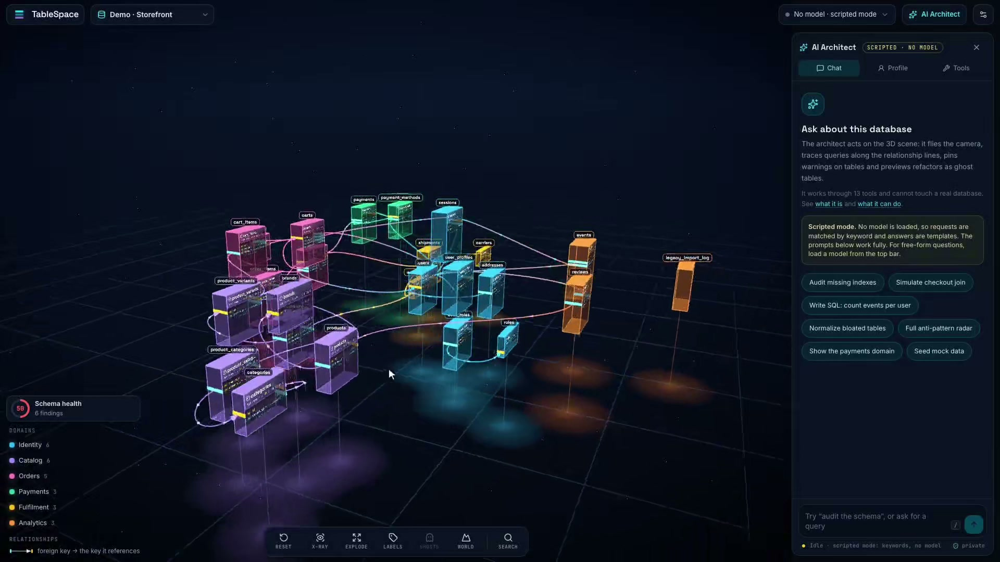

Open a database and it becomes a place. Tables drop in parents first, relationships draw themselves from
key to key, and the camera sweeps in. Then you orbit, search, unfold — or just ask the AI architect to
show you around: it traces a query through the scene, flags the schema's weak spots, proposes refactors
as ghost tables and seeds mock data, all on a model running on your device.

## ✨ The scene

<table>
<tr>
<td width="50%">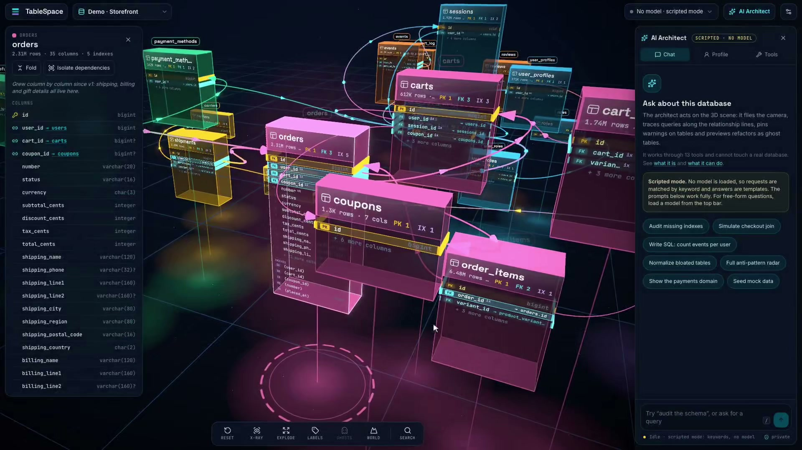</td>
<td width="50%">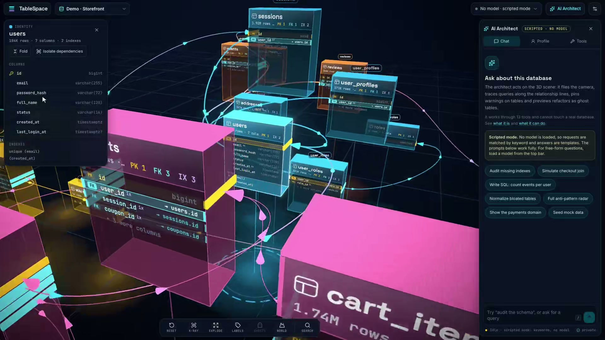</td>
</tr>
<tr>
<td><b>Tables are glass monoliths.</b> Height and depth grow with the row count (log scale), color is the domain, and the face lists the key columns — every column once unfolded. Click a table to fly to it; click it again to fold or unfold its columns.</td>
<td><b>Foreign keys are curves</b> from the foreign key's row to the row of the key it references, with darts travelling the way the arrow points: one for `1:1`, a stream otherwise. Click a relationship to fly it end to end.</td>
</tr>
<tr>
<td>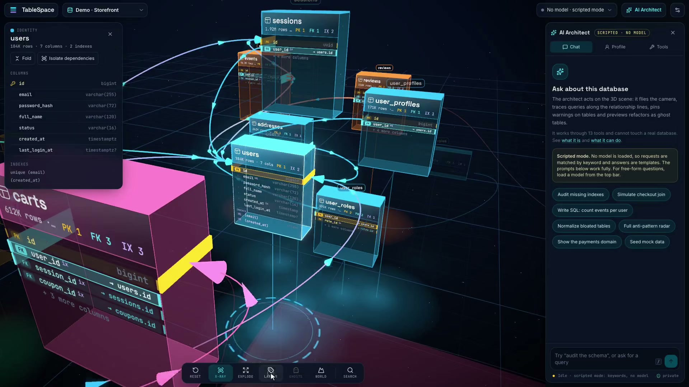</td>
<td>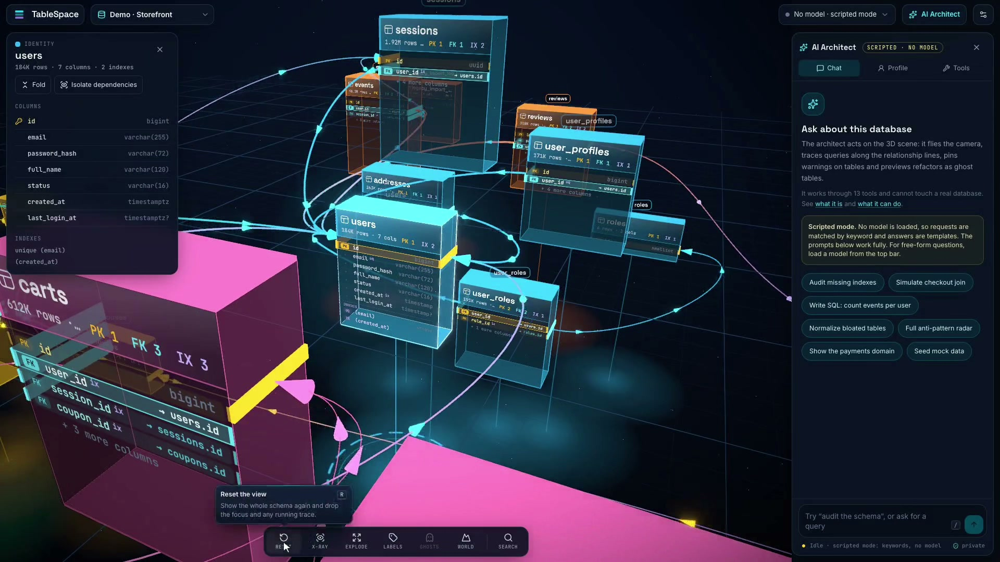</td>
</tr>
<tr>
<td><b>X-ray and labels.</b> X-ray sees the scene through the tables; labels put the cardinality (`N:1`, `1:1`, `M:N`) — or the whole reference — on each curve.</td>
<td><b>The exploded view</b> pulls the clusters apart so nothing hides behind anything. One key (or one click) takes it apart and puts it back.</td>
</tr>
</table>

- **Layout is force-directed** (`d3-force-3d`): related tables and tables of a domain cluster together.
- **The selected table** lifts a little, its frame glows in its domain's color, and the rows at both ends of each of its relationships light up.

## 🤖 The AI architect

<table>
<tr>
<td width="50%">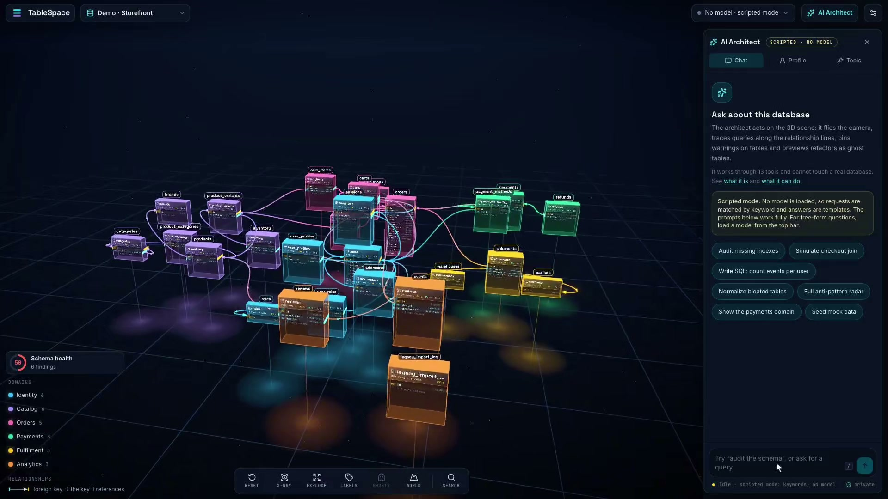</td>
<td width="50%">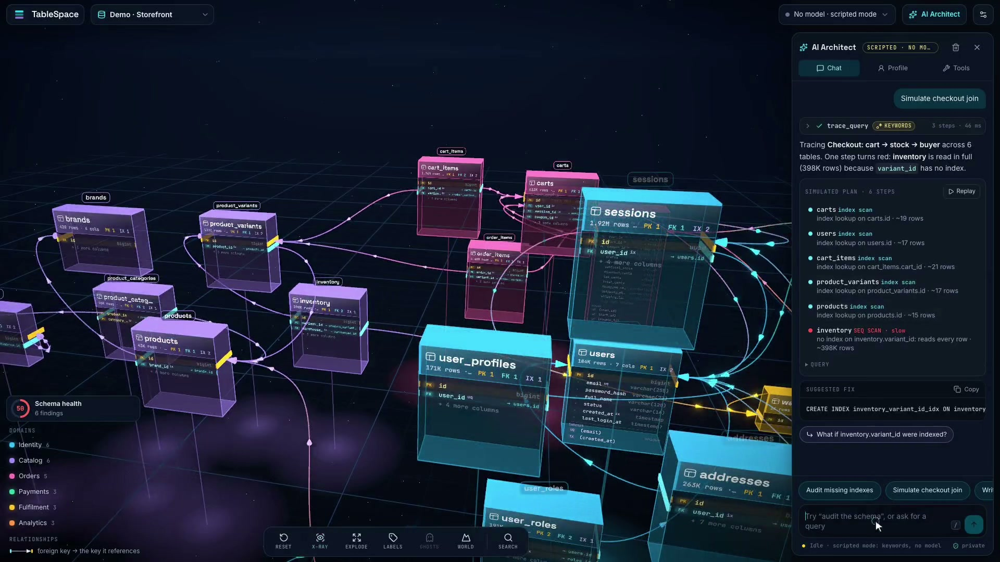</td>
</tr>
<tr>
<td><b>Trace a query.</b> Ask for a join and watch it run table by table, index scans and sequential scans, costs from the row counts. Ask a question in words and <b>write_sql</b> answers with validated PostgreSQL — joins from the real foreign keys — and traces it in the scene.</td>
<td><b>Audit the schema.</b> Missing FK indexes, orphaned tables, God tables, no primary key: each finding plants a badge in 3D space you can fly to.</td>
</tr>
<tr>
<td>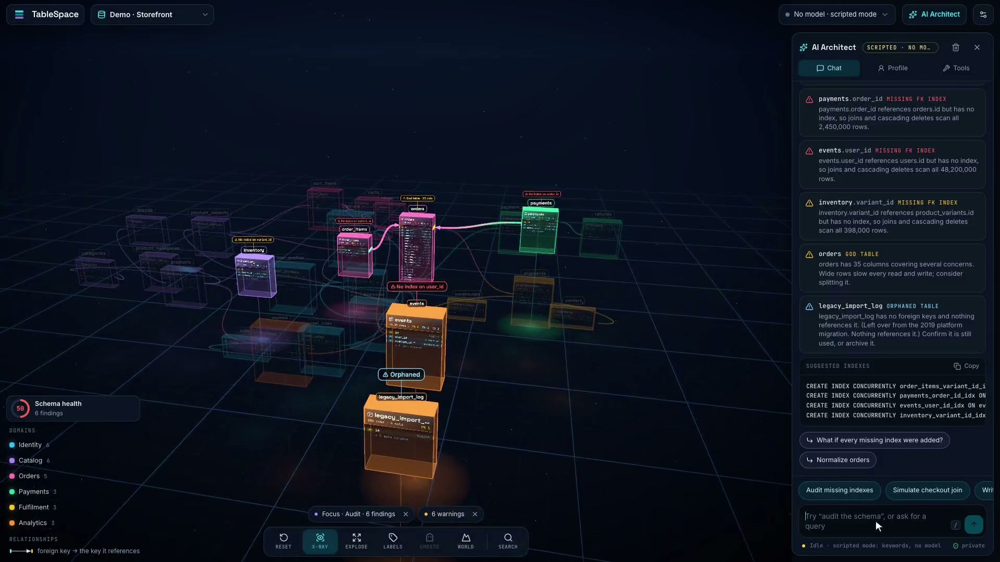</td>
<td>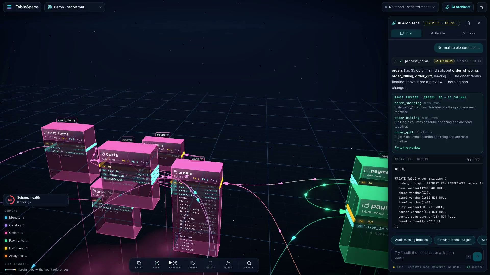</td>
</tr>
<tr>
<td><b>Refactor as ghost tables.</b> Proposals are drawn next to the real schema — rule-based, with the migration SQL — nothing is executed until you say so.</td>
<td><b>Seed mock data</b> in dependency order: parents first, valid foreign keys, tables visibly filling in the scene.</td>
</tr>
</table>

**The AI drawer** drives the scene with thirteen tools. Five read the schema and report: describe tables (columns, keys, indexes), relate tables (join paths, dependants), inspect indexes, a schema overview, and a column search. The rest act on the scene: focus tables, write SQL for a question, trace a query, try a what-if index, propose a refactor (ghost tables + migration SQL), audit for anti-patterns (3D badges), seed mock data in dependency order, and reset the view. One answer can chain several of the reading tools.

## 🌌 Worlds

<table>
<tr>
<td width="33%">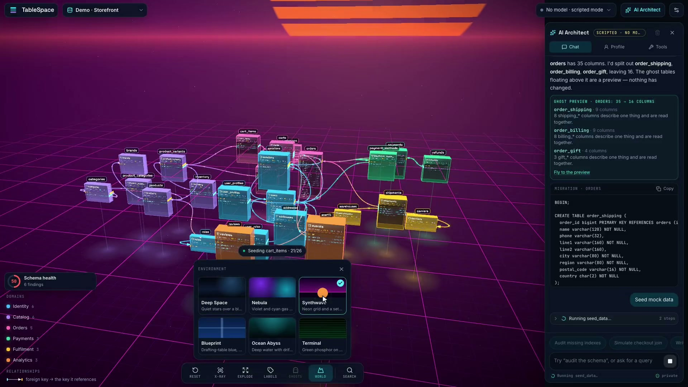</td>
<td width="33%">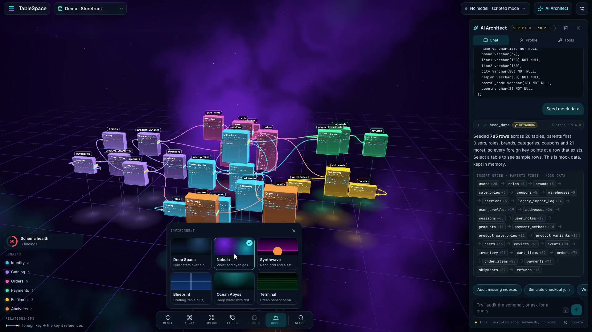</td>
<td width="33%">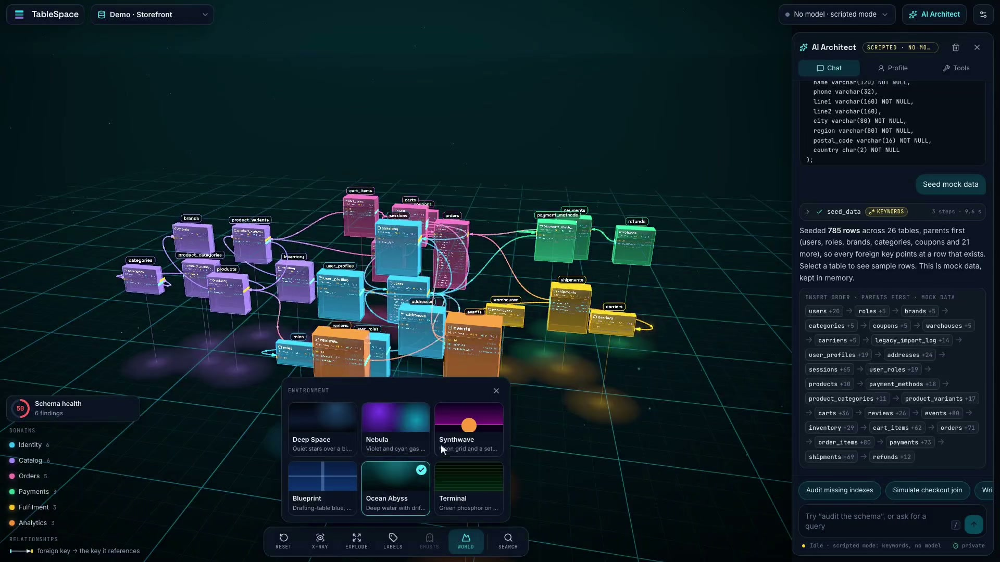</td>
</tr>
</table>

**World** in the dock chooses the environment: Deep Space, Nebula, Synthwave, Blueprint, Ocean Abyss or Terminal. The choice is remembered in this browser, and an environment is one entry in `src/scene/environments.ts` — adding an entry adds it to the picker.

## 🎬 The tour video

**[Watch it on YouTube](https://youtu.be/sxxrlu_RZ_k)** — the opening, orbiting, a table up close, following a foreign key, X-ray, labels, the exploded view, the AI architect (a query trace, an audit, a refactor as ghost tables, seeding) and the environments.

It is recorded by a script, so it can be made again after the app changes: `bun run demo:video` starts the dev server, drives the tour in headless Chrome and encodes the frames with ffmpeg to `docs/demo.mp4` (both must be installed). The tour is the `tour` function in `scripts/record-demo.mjs`; `--fps`, `--crf`, `--width`, `--height`, `--out` and `--url` change the output.

## 🚀 Run it

```bash
git clone https://github.com/shoocstorm/TableSpace.git
cd TableSpace
bun install        # also copies wllama's wasm into public/wllama/
bun run dev        # http://localhost:5183
bun run test       # unit tests (pure logic)
bun run build      # typecheck + production build in dist/
bun run preview    # the production build with the production headers and CSP, http://localhost:5184
```

## 🔍 What is real and what is simulated

| | |
|---|---|
| 3D scene, layout, camera, X-ray, exploded view, search (`⌘K` / `Ctrl+K`) | Real |
| Local model: download, sha256 check, load, streaming, tool choice | Real (wllama, in the page) |
| Schema audit (missing FK indexes, orphaned tables, God tables, no PK) | Real analysis of the schema definition |
| Refactor proposals and migration SQL | Real, rule-based (column-prefix groups, lookup columns); nothing is executed |
| Generated SQL (`write_sql`) | Real: compiled from a validated query description, PostgreSQL dialect. Never executed (there is no database) |
| Query execution plans | **Simulated.** There is no database: a step is an index scan when the join or filter column is indexed, otherwise a sequential scan, with costs from the mock row counts |
| Seeded data | **Mock data in memory.** Generated parents-first with valid foreign keys; nothing is written anywhere |
| Databases | **Mock schemas** bundled with the app |

## 🧠 How the agent works

Small local models can't be trusted to write tool calls free-form, so they don't:

1. **Choose.** The model is shown the tools as lettered options and its choice is read from a single token (below). `answer` is always one of the options.
2. **Fill.** It writes the arguments as JSON under a grammar in which table names, domains and presets are enums built from the active database, so it can't name a table that doesn't exist. The result is validated again in TypeScript.
3. **Run.** The tool does its work deterministically and changes the 3D scene.
4. **Look further, or stop.** If the request has several parts, the tools the other parts ask for run next. Otherwise, if the tool lists tools worth running after it (`then` in `src/agent/tools.ts`), the model chooses between stopping and one of them. Either way the turn repeats from step 2, up to the number of tools set in Settings (3 by default).
5. **Explain.** The model streams a short explanation from the tool's facts; after several tools, one answer from all of them.

A keyword router backs this up: when the model says `answer` to a request that plainly matches a tool, or a step fails, the match is used.

### Lookup tools

The model is given table names and foreign keys, not columns. Five tools read the rest from the schema, and each takes several tables in one call so a question does not cost a call per table:

| Tool | What one call reports |
|---|---|
| `describe_tables` | Up to 6 tables: columns with types, primary key, nullable and unique columns, foreign keys in and out, indexes, foreign keys with no index |
| `relate_tables` | Up to 4 tables: the join path between each pair with the exact columns (through other tables if need be), each table's parents and children, and what depends on it further out |
| `inspect_indexes` | Up to 8 tables, or the whole schema: what each index covers, foreign keys with and without one, indexes another index already covers |
| `schema_overview` | The schema or one domain: counts, the largest, widest and most connected tables, root, junction and unrelated tables |
| `find_columns` | Every table holding a column of a given name or kind (time, number, text, json, boolean, uuid, nullable, unique, foreign key) |

### Several steps in one answer

A request such as *describe orders and check whether its indexes are right* is split at commas, *and*, *then* and *also*, and each part is matched by the keyword rules on its own (`alsoAsked` in `src/agent/router.ts`), with the tables the whole request names when a part names none. The turn starts with the first part's tool and runs the others after it. This needs no model, so it works the same way every time, in scripted mode too.

After that, with a model loaded, the model is asked whether the request needs anything the results do not contain. In practice Qwen3 0.6B almost never says yes: across the live runs below it put 94–100% on stopping after every tool, including on compound requests. Splitting the request is what makes compound requests work; the model's follow-on decision is a backstop.

Only tools that read and report are chained: the five above, the audit and the query trace. A tool that adds something to the scene (a what-if index, ghost tables, mock rows) is never run as a follow-on step; it stays a one-click suggestion under the answer. A tool is not offered twice in a turn, a tool with nothing listed after it ends the turn without a decision being spent, and a one-click prompt always runs exactly the tool it names. Later steps report without moving the camera, so the scene stays where the first step put it.

### One-token decisions

A choice is not written out. The model gets the situation, a question and lettered options, and the first token's log-probabilities are read: a softmax over the option letters gives every option a share, and the largest wins (`src/llm/decide.ts`, ported from Andai's `docs/decider.md`). It scores every option, which the name alone does not. When the request names a table, column or domain, `answer` cannot win and the best-scoring tool is taken: Qwen3 0.6B put most of its weight on `answer` for about half the requests about the schema, and the right tool was usually its runner-up.

The prompt is Andai's with one change: the user's request (and what the turn has found) comes after the options instead of inside the state, so the long unchanging part (the tables, the question, fourteen options) is read once and reused. Measured with Qwen3 0.6B on CPU over the same 30 requests:

| Choosing the first tool | Right | Median per decision | Median per answer |
|---|---|---|---|
| One token, request last (shipped) | **23/30** | 0.40 s | 4.6 s |
| One token, Andai's order | 21/30 | 5.4 s | 10.8 s |
| Spelled-out name (the old way) | 17/30 | 0.17 s | 3.5 s |

Two other layouts were tried and dropped: the question and options before the whole state (13/30), and lettered options inside the old router prompt (0.13 s, but 12/30). The very first decision of a session takes about 5 s while the shared part is read for the first time. Two gates use the scores: a first choice with under 35% loses to a keyword match for a different tool, and a follow-on step needs at least 50% or the turn stops and answers. The shares rank options; they are not calibrated probabilities. If the readout lists no option letter, the model is asked to spell the name out under a grammar instead, as before; Settings can switch the readout off altogether.

Andai's faster decider, the Laya checkpoint, is not used: it runs on MLX through Rust on Apple Silicon and has no browser runtime (Andai's own web build falls back to the chat model for the same reason).

### Seeing what the agent does

Nothing the agent does is hidden. The drawer has three tabs:

- **Chat.** Every answer carries its steps: the tool chosen, the arguments, the run, the explanation. Each step is marked with who decided it (`model`, `keywords`, `you` for a one-click prompt, or `code`), how long it took, and unfolds to the exact prompt sent to the model and its raw reply. A line under the message box says what the agent is doing at that moment.
- **Profile** (`P`). The model and where it runs, what leaves the device (nothing), what the agent has put in the scene with a way to remove each thing, the rules the loop enforces, what it cannot do, the schema summary it is given, its five prompts word for word, and a log of the session.
- **Tools** (`T`). The thirteen tools, read from the registry the agent itself uses: what each leaves in the scene and how to undo it, the description the model is given, the arguments with their allowed values for the active database, and a button to run it.

Settings → AI Architect decides how much the model is allowed to do: choose the tool (or leave that to the keyword rules), read each choice from one token (or have the name spelled out), run up to five tools per answer (or one), explain results (or show the tool's own summary), unfold the steps by default, suggest follow-ups, and reload the last model at startup.

## ⌨️ Keyboard

Hover or tab to any control for a tooltip with its name, its key and what it is for. Press `?` for the full list (Settings → Shortcuts), where single-key shortcuts can also be switched off.

| Key | Does |
| --- | --- |
| `⌘K` / `Ctrl+K` | Search tables and columns |
| `R` · `X` · `E` · `L` · `W` | Reset the view · X-ray · explode · relationship labels · world |
| `F` · `D` · `Esc` | With a table selected: fold or unfold it · isolate its dependencies · deselect |
| `G` | Clear the ghost tables |
| `/` · `A` | Ask the AI Architect · show or hide its drawer |
| `1`…`7` | Run a one-click prompt |
| `P` · `T` · `M` | The agent's profile · its tools · the local model menu |
| `I` · `,` · `?` | Import a schema · settings · shortcuts |

## 🔎 Reading the scene

- **Tables** are glass slabs in their domain's color. Each has a name tag that faces the camera (it gives way to the table's face up close, and a table in front covers the tags behind it), a pool of light on the floor under it and a thread down to the floor, which show where it sits in depth.
- **Relationships** are drawn from the foreign key's row to the row of the key it references: both rows carry on around the slab's side as a pad — cyan for the foreign key, gold for the key it references, the colors of the `FK` and `PK` badges on the faces — and the line leaves the one and lands its **arrowhead** on the other. A foreign key's row also names its target (`→ users.id`). The header counts the table's indexes (`IX n`), an indexed column is marked `ix` (`uq` when the index is unique on it alone), and an unfolded face lists the indexes under the columns, what-if indexes outlined in dashes. **Labels** in the dock (off by default, remembered in this browser) puts a label on each line — the cardinality read along the arrow (`N:1`, `1:1`, `M:N`), or the whole reference (`orders.user_id → users.id  N:1`) for the lines of the selected table or of whatever is in focus, which are also drawn heavier. Darts travel along each line in the arrow's direction.
- **The selected table** lifts a little, its frame glows in its domain's color, and a ring marks its place on the floor. The rows at both ends of each of its relationships light up, on its own face and on the tables it is related to. Flying to a table turns the camera as little as possible: both faces of a table read the same, so the camera stops at whichever is nearer.
- **The opening**: the schema assembles itself. Under a title card the tables drop into place parents first, each relationship draws itself from its foreign key to the key it references, and the camera sweeps in; then the controls fade in. Any key or click skips it, `prefers-reduced-motion` turns it off, and opening another database builds that one the same way (without the title card). The clock is `src/scene/intro.ts`, the title card `src/ui/Intro.tsx`.
- **World** in the dock chooses the environment: Deep Space, Nebula, Synthwave, Blueprint, Ocean Abyss or Terminal. The choice is remembered in this browser. An environment is one entry in `src/scene/environments.ts` (sky gradient, fog, grid, lights, and optional stars, gas clouds, sun and drifting motes); adding an entry adds it to the picker.

## 📝 Writing SQL

Ask a question about the data (*how many orders does each user have? top 10*, *list cancelled orders with total over 10000*) and `write_sql` answers with a query, a sentence saying what it understood, a list of what was checked, and a trace of the query in the scene.

Nobody writes SQL text, the model included. A request becomes a `QuerySpec` (tables, columns, filters, aggregate, grouping, order, limit) and `src/analysis/querybuilder.ts` compiles it:

- **Joins come from the foreign keys.** Tables are connected by the shortest chain of keys, adding the tables in between; tables with no chain between them are refused.
- **Every name exists.** A spec that names an unknown table or column doesn't compile.
- **Values are typed and escaped** from the column's SQL type; a number column compared to text is refused.
- **GROUP BY matches the select list**, and a listing with no limit gets `LIMIT 100`.
- **The finished SQL is read back** by the SQL reader and planned, as a second look; slow scans are listed.
- **Cautions are shown, not hidden:** a `_cents` column compared to a number, a sum that would repeat across joined child rows.

What this guarantees is that the SQL is valid for the schema and joins on real keys. It does not guarantee the query is the one you meant: that depends on how the request was read, which is why the reading is shown in words above the checks.

**How a request is read.** A pattern reader (`inferSpec`) takes what the text states outright: table names, *how many*, *total*, *average*, *per / each / by …*, *top N*, *latest*, `column <operator> value`, status words like *cancelled*. With a model loaded, it is asked a second grammar-constrained question whose values are all enums (the columns of the tables involved, operators, and literals copied from the request), and its answer is filtered by `gateSpec`: a column, filter or ordering is kept only if the request's own words support it, and aggregates, grouping and limits are never taken from the model. That filter exists because of a measurement: Qwen3 0.6B, left alone, added filters like `status = 'signed'`, stray aggregates and `LIMIT 1` to simple requests.

Limits: one SELECT with inner joins, AND-ed filters, one aggregate. No OR, subqueries, HAVING, date arithmetic, outer joins or window functions; a request that needs them gets the nearest query this can express, and the "what I understood" line is where that shows.

**Scripted mode.** With no model loaded, the keyword router picks the tool and the tool's own summary is the answer. The prompt chips work fully, so the app can be tried before any download. The drawer says when it is in this mode.

Models: Qwen3 0.6B (639 MB) and Qwen3 1.7B (1.1 GB), GGUF files downloaded once from Hugging Face at a pinned commit, verified against a pinned sha256, and kept in the browser's OPFS storage.

### The result table

A generated query is run on the mock rows, and the chat shows its first rows. **Open table** (or a click on that preview) opens the whole result in a dialog:

- click a column header to sort (again to reverse, a third time to clear); nulls stay last
- search every column, or filter one: plain text means "contains", and `=x`, `!=x`, `>x`, `>=x`, `<x`, `<=x`, `10..50`, `null`, `!null` also work
- hide columns, page through 25 / 50 / 100 / all rows, click a row to see every value in full
- the bottom row totals and averages measure columns and counts distinct values in the others
- **Copy** puts the rows shown on the clipboard tab-separated (pastes into a spreadsheet); **CSV** and **JSON** download them

The dialog works on what the query returned (at most its `LIMIT`), and exports follow the current filters, order and visible columns. The logic is in `src/analysis/resultview.ts`.

## 🗄️ Add a database

1. Copy `src/schema/saas.ts` and describe your tables with the `pk` / `col` / `fk` / `idx` helpers. Each table needs a `domain` (for color and clustering) and a `rows` estimate (for size).
2. Add query `presets` if you want named traces.
3. Add the schema to `SCHEMAS` in `src/schema/registry.ts`.

The schema tests in `src/analysis/analysis.test.ts` then check it: foreign keys point at real columns, presets parse, and seeding produces valid rows.

## 🚢 Deploy to Firebase Hosting

```bash
firebase hosting:sites:create tablespace-3d   # once; or change "site" in firebase.json to a site you own
bun run deploy:web                            # build + firebase deploy --only hosting
```

`.firebaserc` points at the `aldrick-ai` project. `firebase.json` sends the headers the app depends on:

- `Cross-Origin-Opener-Policy: same-origin` and `Cross-Origin-Embedder-Policy: require-corp` make the page cross-origin isolated, which gives wllama `SharedArrayBuffer` and so multiple threads. Without them the model still runs, on one thread.
- The CSP allows only what is used: `'wasm-unsafe-eval'` and `worker-src blob:` for wllama, and `connect-src` to Hugging Face for model downloads.

Any other static host works if it can send the same headers. `vite.config.ts` reads them from `firebase.json`, so dev, preview and production agree.

**PWA.** The build includes a web manifest and a service worker (`vite-plugin-pwa`): the app shell is precached, so TableSpace can be installed and opens offline. wllama's wasm is cached on first use; models stay in OPFS. A new deploy takes over on the next visit and reloads the page once.

## 📱 Phones

Under 640 px the AI drawer becomes a bottom sheet with the scene above it, tables stay folded until tapped, and the scene is lighter (lower pixel ratio, weaker bloom, fewer particles, no star field). Models load CPU-only with a 2,048-token context on phones, because iOS closes a tab that uses too much memory; a load that fails or crashes the tab steps down further on the next try. `prefers-reduced-motion` stops particle flows and makes camera moves instant.

### Models on a phone

iOS closes a Safari tab that grows past its memory limit, with no error: the page just reloads. The 639 MB Qwen3 0.6B file did that beside the 3D scene. The loader now follows what BloomGrid measured for the same problem (`src/llm/device.ts`, `models.ts`):

- **Phones list one model**, `Qwen3 0.6B · phone`: the same 0.6B model as a 397 MB Q4_K_M file. A bigger model is refused on a phone and never autoloaded there; one downloaded earlier is still listed so it can be deleted.
- **Lean load options on the CPU plan** (`loadParams`): q8_0 K and V cache with flash attention, one sequence instead of wllama's four, 256-token batches.
- **Prompts are trimmed to the loaded context** (`fitMessages`): phones load 2,048 tokens, or 1,024 after a failure, and a longer prompt would fail.
- **The scene holds still while a phone warms a model up**, so the load has the CPU and no frame allocates beside it.
- As before: a failed load steps down a level, and a page that died mid-load is recognised on the next launch, explained, retried lighter and not autoloaded again.

Measured in headless Chrome emulating an iPhone (its user agent and screen, the compat engine build): the page with the scene and the loaded model holds about 1.2 GB (the scene alone about 0.2 GB), CPU only, 2,048-token context. The first load peaked near 1.6 GB while the file was also being downloaded and verified.

## ✅ What was checked

- `bun run test`: 135 unit tests over the graph, layout, audit, schema lookups, SQL reader, plan simulation, query builder, refactor proposals, seeding, grammar, router, the one-token readout and the steps a turn reports, including turns of several steps (the model's side of those is a stand-in).
- The agent with Qwen3 0.6B in headless Chrome (CPU, wllama 3.6.1) over 30 requests: 15 that name their tool plainly, 9 that no keyword rule matches, and 6 compound ones. The table above is from these runs. Five of the six compound requests ran every tool they asked for; in the sixth (*describe orders and check whether its indexes are right*) the second part went to the audit's missing-index rule instead of `inspect_indexes`. None of the 24 others ran a second tool. Every generated query in the tests is read back and planned, and every pair of connected tables in both schemas is joined and parsed.
- The production build under `bun run preview`, in headless Chrome at 1440×900 and 390×844 (emulated phone): cross-origin isolated, service worker registered, no console errors or CSP violations; every chip, typed SQL, search, the second schema and the exploded view were looked at in screenshots.
- Qwen3 0.6B loaded in Chrome on a Mac (WebGPU, 29/29 layers, about 125 tok/s) and answered free-form prompts through the agent loop, including seven SQL requests whose output was read by hand. Generated SQL was not run against a real PostgreSQL.

Not checked: a real phone (emulation only; the phone model was loaded and prompted in iPhone emulation, which has no iOS memory limit), Safari and Firefox, and an actual Firebase deploy.

## 📁 Layout

```
src/schema/     schema types, the mock databases, graph helpers
src/layout/     force-directed layout
src/analysis/   audit, SQL reader, plan simulation, query builder, refactor proposals, seeding   (pure, tested)
src/scene/      React Three Fiber components
src/agent/      tools, grammars, prompts, keyword router, the turn
src/llm/        wllama engine, model catalog, device load plans, sha256           (ported from Andai)
src/state/      zustand stores: scene, chat, ui, settings
src/ui/         top bar, dock, command palette, inspector, AI drawer (chat, steps, profile, tools), settings, shortcuts, tooltips
```
